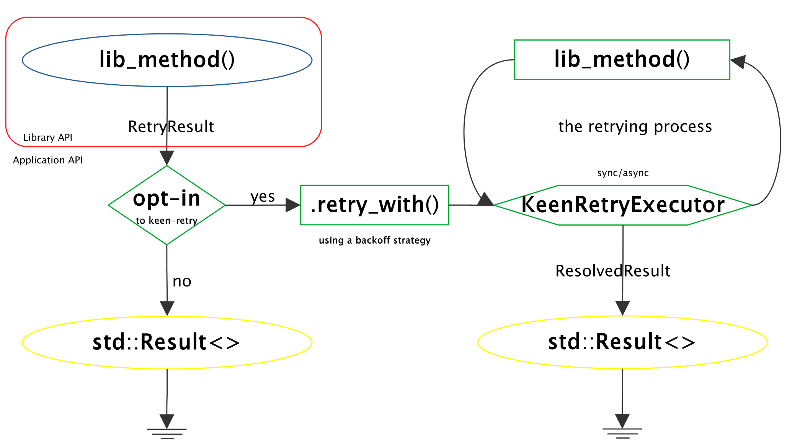
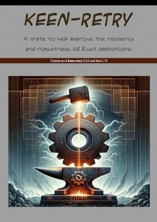

# keen-retry


## Introduction

The `keen-retry` crate is designed to provide a zero-cost, flexible, and robust way to implement not only retry logic in Rust applications,
and to make retries observable and composable, especially when retry logic lives across library and application boundaries.


## Features

  -  **Zero-Cost Abstraction**: Leverages Rust's powerful type system and compile-time optimizations to offer retry capabilities with no runtime overhead
                                (see benches/zero_cost_abstractions.rs).
  -  **Clear Error Discrimination**: Retrying operations that fail due to non-transient errors is futile, can waste resources and may ruin the application performance
                                     -- model retryability as `RetryResult::{Transient,Fatal}` so callers don’t accidentally retry permanent failures.
  -  **Instrumentation and Logging**: Structured outputs + helpers to summarize retry errors + hook points to attach your logging/metrics, so you can fully inspect where your latency and resource utilization is going.
  -  **Composable across lib/app boundaries**: library functions return retry-aware results; apps decide policy and can nest retries without losing context and avoiding unreasonable retrying times. 
  -  **Async/Await Support**: First-class support for asynchronous programming, with async-friendly instrumentation hooks, backoff, and operation executors.
  -  **Flexible Backoff Strategies**: In addition to the recommended "exponential backoff with jitter", allows custom strategies to suit different usage scenarios.


## When to use this crate
Use `keen-retry` when you need "retry as a value" structured outcomes, payload propagation, and diagnostic artifacts (especially in libraries and stream-heavy async code).
If you just need "retry this closure with exponential backoff", `backoff` and `backon` may be simpler.


## Quick Start

### Integrate your Library / API

The first step is to have every retryable operation from your Library or API returning the enriched `RetryResult` type, which clearly discriminates between `Ok`, `Fatal` and `Transient` variants:

```rust
/// Wrapper around [Self::connect_to_server_raw()], enabling `keen-retry` on it
pub async fn connect_to_server(&self) -> RetryProcedureResult<ConnectionErrors> {
  self.connect_to_server_raw().await
    .map_or_else(|error| match error.is_fatal() {
                   true  => RetryResult::Fatal     { input: (), error },
                   false => RetryResult::Transient { input: (), error },
                 },
                 |_| RetryResult::Ok { reported_input: (), output: () })
}
```

### Usage

Now, in the application, you may use it via the zero-cost functional API:
```rust
let resolved = connect_to_server()
    .retry_with(|_| connect_to_server())
    .<one-of-the-backoff-strategies>(...)
    .<instrumentation-facilities>(...)
    .<mapping-of-outputs-and-errors>(...);
```

### The `keen-retry` Diagram




For more details, please refer to `tests/use_cases.rs`, which contains advanced
demonstrations such as how to add a fully fledged instrumentation (as seen in production applications),
how to compose nested retry logics and how to implement the versatile "Partial Completion with Continuation
Closure" design pattern.


## How `keen-retry` differs from mainstream retry crates

`keen-retry` targets a deeper problem than general-purpose retry crates like `retry`, `backoff`, or `backon`: it treats retries as values you can compose and observe,
especially across library/application boundaries and in stream-heavy async code.

If all you need is “retry this closure with backoff”, those crates are often simpler. This section explains the design choices that make `keen-retry` different.


### Two-level result model (`RetryResult` → `ResolvedResult`)

`keen-retry` models retryability explicitly in the operation’s return value. Instead of returning only `Result<T, E>`, operations return a 3-way `RetryResult`: `Ok`, `Transient`, or `Fatal`.

This separates classification (“should we retry?”) from policy (“how and how long do we retry?”), which is especially useful when retryable operations are exposed by libraries and consumed by applications.

When the retry procedure runs, the result is upgraded into a `ResolvedResult`, which represents the final outcome and can carry retry history: `Ok` (succeeded immediately), `Recovered` (succeeded after transient
failures), `GivenUp` (only transients until retry limit), `Unrecoverable` (transient failures followed by a fatal), or `Fatal` (fatal on first attempt).

Note: other crates also support retryable vs non-retryable outcomes (e.g. `retry::OperationResult`), but `keen-retry` bakes in payload propagation and a richer final “retry artifact” that is designed to be composed and inspected.


### Zero-cost when retries don’t happen (benchmarked)

`keen-retry` is designed so that adopting the “retry as a value” model does not impose overhead when retries are not exercised.
In other words: when an operation succeeds immediately or fails fatally on the first attempt (i.e., no `Transient` path), the
retry wrapper gets optimized down to the equivalent of a hand-written `Result<T, E>` flow.

The repository includes a Criterion benchmark (`benches/zero_cost_abstractions.rs`) that compares the use cases -- more details bellow.


### Ownership-friendly retries: zero-copy input propagation

Many retry helpers crates treat the operation as a closure returning `Result<T, E>`.
That model works well when inputs are cheap to clone or can be recreated on demand, but it gets awkward in stream pipelines and consumer-style operations,
where the input is *owned* and may be partially consumed before an error occurs.

`keen-retry` makes the ownership model explicit in `RetryResult`:
 * On success, you get `Ok { reported_input, output }` -- where `reported_input`, if present, may be derived from the original input for instrumentation.
 * On failure, you get the original input back as `Transient { input, error }` or `Fatal { input, error }`.

This enables retry loops that can re-attempt work without requiring Clone on the input or side channels to stash state.


### Different observability story: Built-in diagnostics and observability hooks -- diagnostics are part of the value 

`keen-retry` treats observability as a first-class feature, not an afterthought. The `ResolvedResult` type includes facilities for generating succinct diagnostic reports — e.g., aggregating a list of transient errors encountered across all retry attempts into a compact
occurrence-count map (via the built-in error mapping closure `errors_to_occurrences_count` or your custom one). This is designed for production use where you want rich logs without writing boilerplate instrumentation code every time.

For production logging and metrics, `ResolvedResult` also provides hook points like `.inspect_recovered()`, `.inspect_given_up()`, and `.inspect_unrecoverable()`, so instrumentation can be attached directly to the resolved outcome without external state.

To keep logs concise, the crate includes helpers:
 * `loggable_retry_errors(&Vec<E>) -> String` to serialize retry error occurrences compactly,
 * `errors_to_occurrences_count(Vec<E>, E) -> HashMap<E, u16>` to build an occurrence-count map when you own the error list.

→ You can also enrich the retry payload with context (e.g., a start timestamp) via `.map_input(...)`. Please refer to `tests/use_cases.rs`.


### Composable, fluent pipeline (retry as a value)

`keen-retry` is designed so that library code can return a retry-aware value (`RetryResult`), and application code can later attach retry policy, backoff, and instrumentation in a fluent, composable way.
This makes nested retries (library retries inside application retries) easier to express without losing context or inventing ad-hoc state passing.

In pseudo-code:
```rust
// One attempt produces a retry-aware value.
let attempt = connect_to_server().await; // -> RetryResult<...>

// The application upgrades it into a retry procedure with policy + observability.
let resolved = attempt
  .retry_with_async(|_| connect_to_server())
  .exponential_jitter_backoff(...)
  .inspect_recovered(...)
  .map_ok(...)
  .into_result_mapping_errors(your_metrics_aggregation);
```

Unlike “retry a closure until it returns Ok”, this style separates classification (in the library) from policy (in the app), and keeps the retry process inspectable.


### Advanced pattern: partial completion via continuation closures

Some retryable operations are *not* “all-or-nothing”. They may partially complete work and you may want subsequent attempts to resume from the remaining work rather than restart from scratch
(e.g., broadcasting to multiple targets, where some succeeded and only a subset failed transiently). The `tests/use_cases.rs` file includes a worked example of this pattern under the name
**“Partial Completion with Continuation Closure”**.

The key idea is that the “retry payload” can itself be a **callable continuation**: instead of re-applying the same input on every attempt, the continuation captures progress
(such as the remaining targets) and, on each attempt, performs only the unfinished work before returning a new retry outcome.
In the example, this is implemented by building a continuation closure that retains the list of pending sockets and re-runs only the transient failures on the next attempt.

*How this compares to mainstream retry crates*: you can implement “partial completion” with crates like `retry`, `backoff`, or `backon`, but it typically lives as an application-specific state machine
hidden inside the retried closure. Those crates mostly model retries as “re-run the same closure/future until it returns Ok”, so keeping progress means maintaining mutable state across attempts
(often via captured variables or shared state). For example, `retry` exposes `OperationResult::{Ok, Retry, Err}` and will keep calling the closure until it returns `Ok` or `Err`,
which makes “resume where you left off” possible but entirely manual.

With `backon`, you can carry owned state explicitly via `RetryableWithContext` (useful to avoid async capture/lifetime issues), but you still implement the “remaining work” bookkeeping yourself inside
that context, and the end result is still a plain `Result` rather than a first-class “retry artifact”.

In contrast, `keen-retry` makes the “continuation” itself a natural retry payload: each transient failure can return the updated continuation (representing remaining work), so the retry loop composes it without
requiring ad-hoc external state plumbing. This tends to keep complex retry workflows (like partial completion) more explicit and more composable when you have nested retries across library/application layers.


### Async integration knobs (Tokio/futures/no-async)

Like many crates mentioned here, `keen-retry` supports both synchronous and async retry execution via dedicated executors (`KeenRetryExecutor` and `KeenRetryAsyncExecutor`).

Async support is also feature-gated: by default the crate enables async with the additional dependencies `futures` and `tokio`, and it also provides a no-async option for builds that want to avoid async runtime integration.


### How it compares, at a glance

**Legend**:
 * “Built-in” means modeled directly by the crate’s primary types/APIs.
 * “Manual” means possible, but you’ll implement it via captured state/context + notify/callbacks.

| **Feature**                                      | `retry`                                   | `backoff`                                      | `backon`                                    | `keen-retry`                                                     |
|--------------------------------------------------|-------------------------------------------|------------------------------------------------|---------------------------------------------|------------------------------------------------------------------|
| **Default meaning of “retryable”**               | `Retry` means retry; `Err` means stop     | `backoff::Error::{Transient, Permanent}`       | Retries when `.when(err)` is true           | `RetryResult::{Ok / Transient / Fatal}`                          |
| **3-way retry outcome type**                     | Yes (`Ok / Retry / Err`)                  | Yes (`Result<Ok, Backoff:Error<E>>`)           | No (still `Result<Ok, Err>`)                | Yes (`Ok / Transient / Fatal`)                                   |
| **Where the retryability lies**                  | At the type-level (`OperationResult`)     | At the err variant level (`backoff::Error<E>`) | Call-site policy predicate (`.when(...)`)   | At the type-level (`RetryResult`)                                |
| **Final outcome taxonomy + retry history value** | Manual                                    | Manual                                         | Manual                                      | Built-in via `ResolvedResult` (e.g. `Recovered/GivenUp/...`)     | 
| **Ownership-friendly payload propagation**       | Manual via captured state                 | Manual via captured state                      | Manual via `.context(...)`                  | Built-in: original input carried in `Transient/Fatal`            | 
| **Observability hooks + summaries**              | Manual                                    | Per-attempt `notify` (manual aggregation)      | Per-attempt `notify` (manual aggregation)   | Built-in “retry artifact” + hooks + summary helpers              |
| **Full `async` support**                         | No                                        | Partial: per-attempt `notify` is still sync    | Partial: per-attempt `notify` is still sync | Yes. The final "retry artifact" doesn't use `notify` for metrics |
| **Partial completion / continuation workflows**  | Manual state machine in closure           | Manual state machine in closure                | Manual state machine via context            | Pattern supported naturally as retry payload/continuation        |
| **Zero-cost non-retry path (benchmarked)**       | Not claimed                               | Not claimed                                    | Not claimed                                 | Yes (see `benches/zero_cost_abstractions.rs`)                    |
| **Companion guide**                              | Docs/examples                             | Docs/examples                                  | Docs/examples                               | Yes (book + patterns)                                            |

**Compared versions (verified 2026-03-02):** `retry` 2.2, `backoff` 0.4, `backon` 1.6, `keen-retry` 0.5.

## Performance Analysis

`keen-retry` has been rigorously benchmarked to ensure it adheres to the zero-cost abstraction principle, crucial in systems programming.
Our benchmarks, available at `benches/zero_cost_abstractions.rs`, demonstrate the efficiency of the crate.


## The Book

For a deep dive into the applicable Design Patterns, principles, strategies, and best practices for using `keen-retry` effectively,
be sure to explore our companion [keen-retry crate's Book](docs/keen-retry-book.pdf), which serves as a definitive guide, providing insights and practical
examples to harness the full potential of `keen-retry` in various software development scenarios.

[](https://archive.org/download/keen-retry-book/keen-retry-book.pdf)


## Maintenance Disclaimer

 * This crate has reached a stable API, allowing several patterns (as demonstrated in the companion book).
   -- the concepts, models and core ideas are solid, and the API is likely not to change significantly.
 * Extensive tests prove both the implementation is correct and the intended use cases are addressed
   -- so no bug-fix releases are expected.
